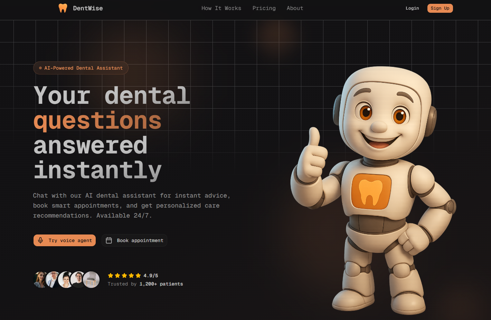
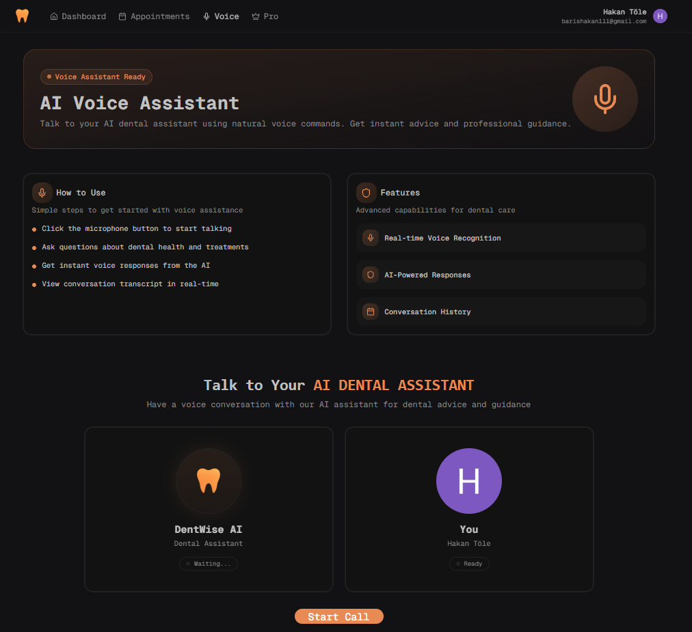
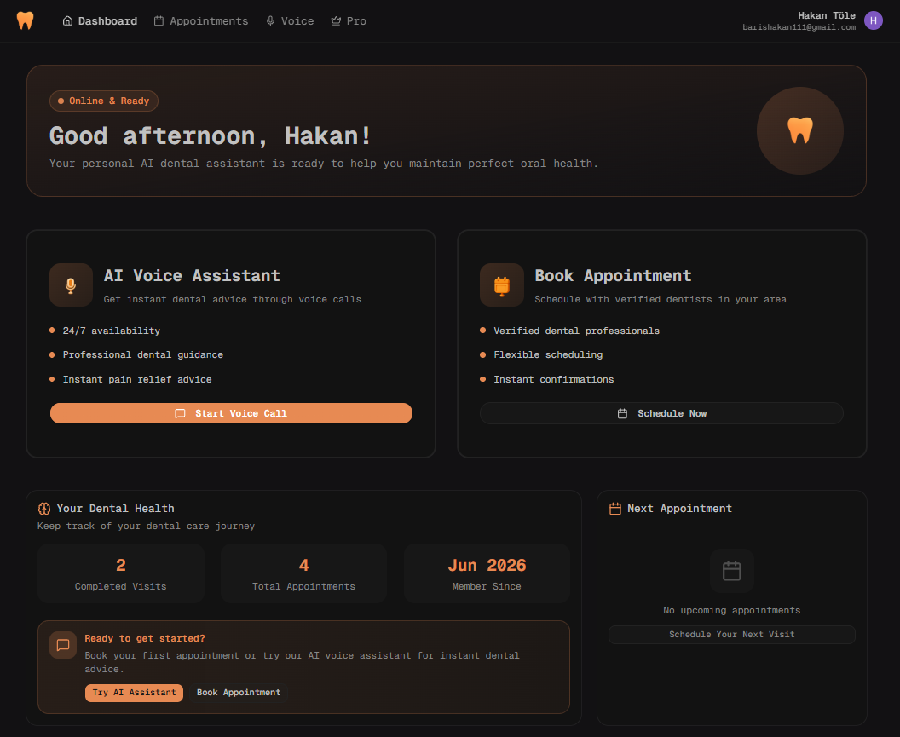
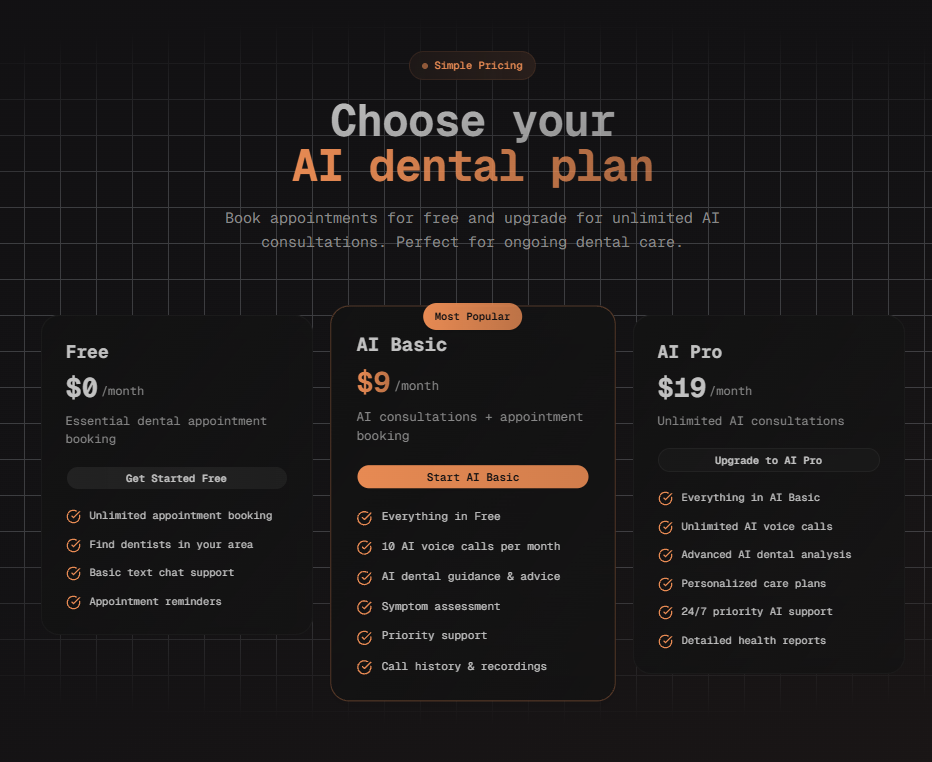
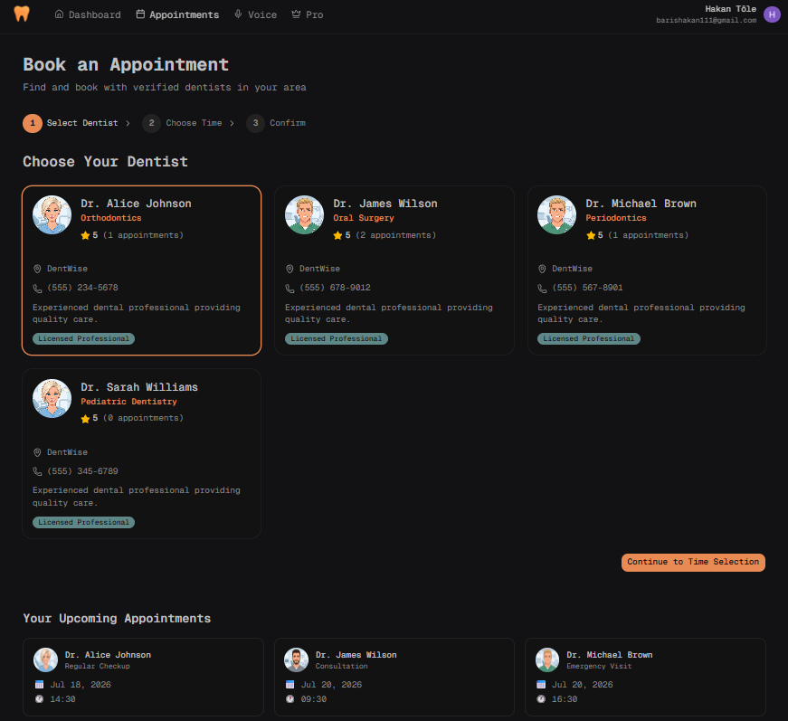
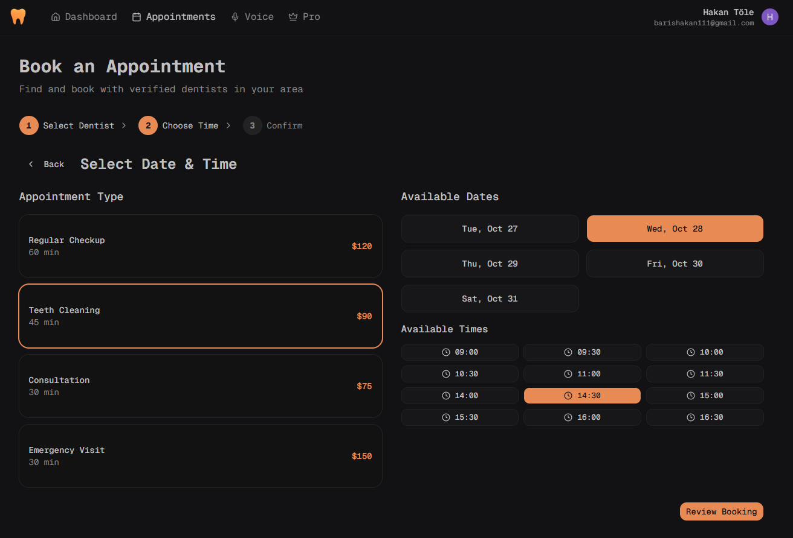
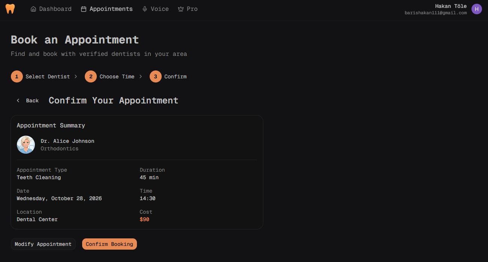
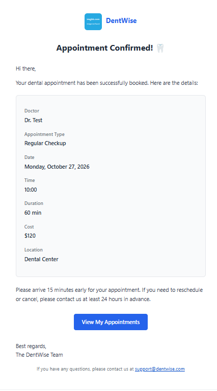

<div align="center">
  

  # DentWise

  **AI-powered dental care SaaS** — book appointments with dentists, talk to a voice AI assistant about your dental health, and manage everything from a personal dashboard.

  
  
  
  
  
  
  
</div>

<p align="center">
  
</p>

## Screenshots

### Landing Page

| Hero | How It Works |
| --- | --- |
|  |  |

| Ask About Anything Dental | Call to Action & Footer |
| --- | --- |
|  |  |

### Voice AI Assistant

Talk to the AI dental assistant in real time with your voice (Pro plan).

<p align="center">
  
</p>

### App

| Dashboard | Pricing |
| --- | --- |
|  |  |

| Appointments — Choose a Dentist | Appointments — Pick Date & Time |
| --- | --- |
|  |  |

| Appointments — Confirm | Appointment Confirmation Email |
| --- | --- |
|  |  |

## Features

- **Authentication** — sign up / sign in with Clerk; users are synced to the database on first login.
- **Landing page** — hero, how it works, sample questions, pricing and call to action.
- **Appointment booking** — 3-step flow: choose a dentist → pick a date & time → confirm.
- **Email confirmations** — appointment confirmation emails built with React Email and sent via Resend.
- **Voice AI assistant** — real-time voice conversations about dental health powered by Vapi (Pro plan).
- **Subscriptions** — plans and paywalled features managed with Clerk Billing.
- **User dashboard** — upcoming appointment, activity overview and dental health summary.
- **Admin panel** — stats, recent appointments, and add / edit / activate dentists.

## Tech Stack

| Area | Tools |
| --- | --- |
| Framework | Next.js 15 (App Router, Turbopack), React 19, TypeScript |
| Styling | Tailwind CSS 4, shadcn/ui, Radix UI, lucide-react |
| Data | PostgreSQL, Prisma ORM, TanStack Query |
| Auth & billing | Clerk |
| Voice AI | Vapi |
| Email | Resend, React Email |
| Tooling | Biome (lint & format) |

## Getting Started

### Prerequisites

- Node.js 18+
- A PostgreSQL database (e.g. [Neon](https://neon.tech))
- Accounts for [Clerk](https://clerk.com), [Vapi](https://vapi.ai) and [Resend](https://resend.com)

### Installation

```bash
git clone https://github.com/HakanTole1/Dentwise-SaaS-.git
cd Dentwise-SaaS-
npm install
```

Copy the example environment file and fill in your own keys:

```bash
cp .env.example .env
```

Create the database tables and start the dev server:

```bash
npx prisma generate
npx prisma db push
npm run dev
```

Open [http://localhost:3000](http://localhost:3000).

## Environment Variables

| Variable | Description |
| --- | --- |
| `DATABASE_URL` | PostgreSQL connection string |
| `NEXT_PUBLIC_CLERK_PUBLISHABLE_KEY` | Clerk publishable key |
| `CLERK_SECRET_KEY` | Clerk secret key |
| `NEXT_PUBLIC_VAPI_API_KEY` | Vapi public API key |
| `NEXT_PUBLIC_VAPI_ASSISTANT_ID` | Vapi assistant ID |
| `RESEND_API_KEY` | Resend API key |
| `ADMIN_EMAIL` | Email address that gets access to `/admin` |
| `NEXT_PUBLIC_APP_URL` | Base URL of the app (e.g. `http://localhost:3000`) |

## Project Structure

```
prisma/              Database schema (User, Doctor, Appointment)
public/              Images and static assets
src/
  app/               Routes: /, /dashboard, /appointments, /voice, /pro, /admin, /api
  components/        Feature components (admin, appointments, dashboard, landing, emails) and shadcn/ui
  hooks/             React Query hooks
  lib/               Server actions, Prisma client, Resend client and utilities
```

## Scripts

| Command | Description |
| --- | --- |
| `npm run dev` | Start the dev server |
| `npm run build` | Production build |
| `npm run start` | Start the production server |
| `npm run lint` | Lint with Biome |
| `npm run format` | Format with Biome |

## Author

**Hakan Barış Töle** — [@HakanTole1](https://github.com/HakanTole1)

## Acknowledgements

This project was built by following the DentWise tutorial by [Burak Orkmez](https://github.com/burakorkmez).

- Tutorial video: [YouTube](https://www.youtube.com/watch?v=MhGV5TekJ8Y)
- Original repository: [burakorkmez/dentwise](https://github.com/burakorkmez/dentwise)
